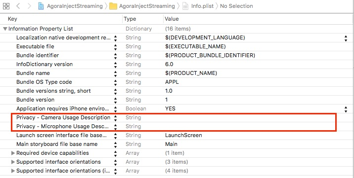
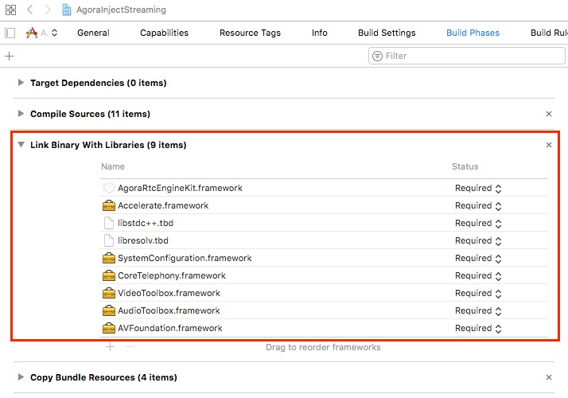
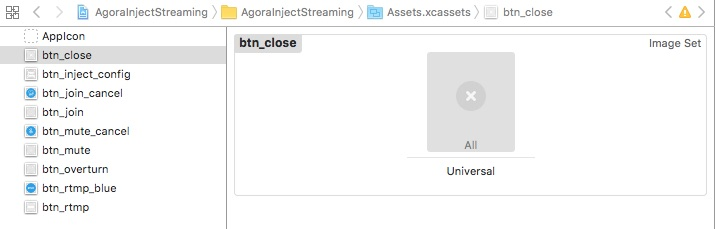
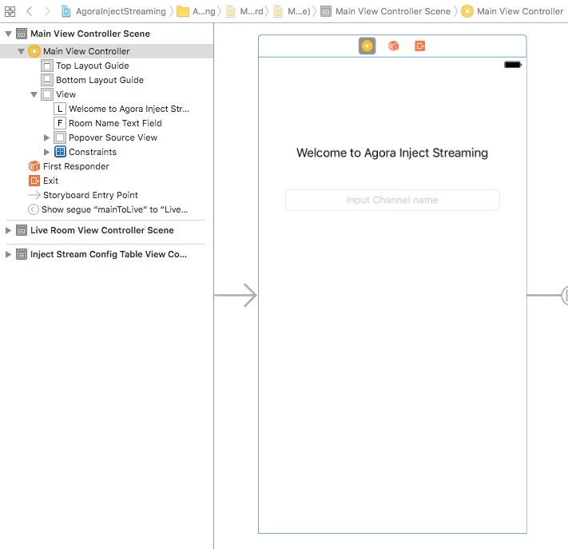
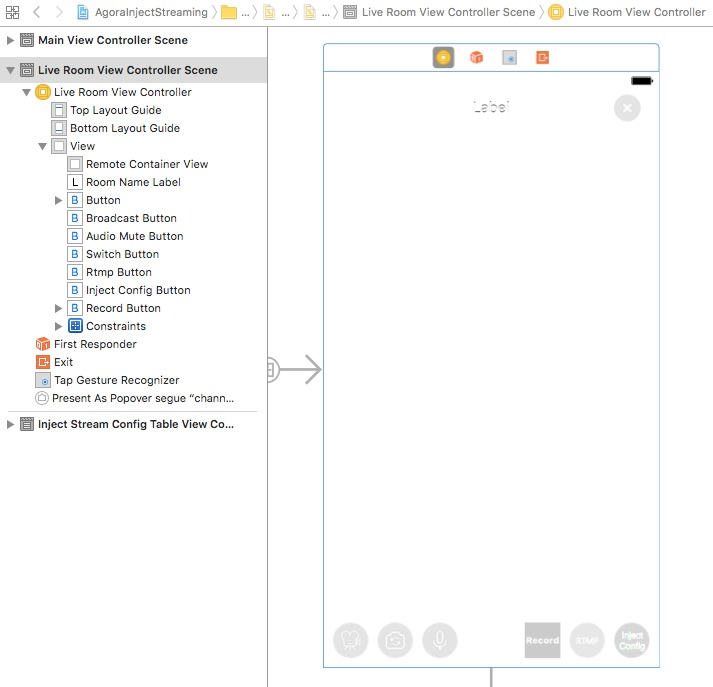
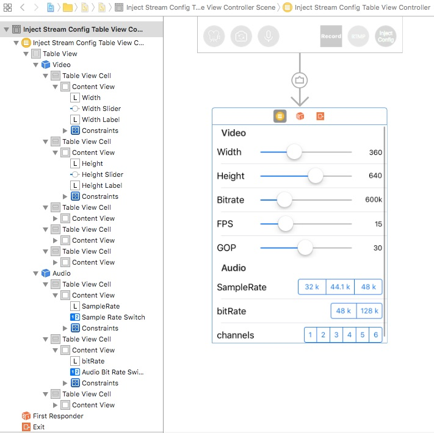

# Injection Streaming iOS for Swift

This tutorial describes how to add Agora injection streaming for CDN live to your iOS applications using Swift and the Agora Video SDK.

With this sample app you can:

- [Join / leave channel](#create-liveroomviewcontroller-class-agora-extension)
- [Add injection stream URL](#create-liveroomviewcontroller-helper-delegate-methods)
- [Remove injection stream URL](#create-ibaction-methods)
- [Switch cameras](#create-ibaction-methods)
- [Mute / unmute audio](#create-ibaction-methods)

## Prerequisites
- Xcode 8.0+
- Physical iOS device (iPhone or iPad)
	
	**Note:** Use a physical device to run the sample. Some simulators lack the functionality or the performance needed to run the sample.

## Quick Start

This section shows you how to prepare, build, and run the sample application.

- [Create an Account and Obtain an App ID](#create-an-account-and-obtain-an-app-id)
- [Update and Run the Sample Application](#update-and-run-the-sample-application) 


### Create an Account and Obtain an App ID
To build and run the sample application, you must obtain an app ID: 

1. Create a developer account at [agora.io](https://dashboard.agora.io/signin/). Once you finish the sign-up process, you are redirected to the dashboard.
2. Navigate in the dashboard tree on the left to **Projects** > **Project List**.
3. Copy the app ID that you obtained from the dashboard into a text file. You will use this when you launch the app.


### Update and Run the Sample Application 

1. Open `AgoraInjectStreaming.xcodeproj` and edit the `KeyCenter.swift` file. In the `AppId` declaration, update `<#Your App Id#>` with your app ID.

	``` Swift
    static let AppId: String = <#Your App Id#>
	```

2. Download the [Agora Video SDK](https://www.agora.io/en/download/). Unzip the downloaded SDK package and copy the `AgoraRtcEngineKit.framework` file from the SDK `libs` folder into the sample application's `AgoraInjectStreaming` folder.
	
3. Connect your iPhone or iPad device and run the project. Ensure a valid provisioning profile is applied or your project will not run.

## Steps to Create the Sample 

- [Set Permissions and Add Frameworks and Libraries](#set-permissions-and-add-frameworks-and-libraries)
- [Design the User Interface](#design-the-user-interface)
- [Create the MainViewController Class](#create-the-mainviewcontroller-class)
- [Create the LiveRoomViewController Class](#create-the-liveroomviewcontroller-class)
- [Create the InjectStreamConfigTableViewController](#create-the-injectstreamconfigtableviewcontroller-class)


### Set Permissions and Add Frameworks and Libraries

Open the `info.plist` file. Enable the camera and microphone privacy settings for the application.



Under the **Build Phases** tab, add the following frameworks and libraries to your project:

- `AgoraRtcEngineKit.framework`
- `Accelerate.framework`
- `libc++.tbd`
- `libresolv.tbd`
- `SystemConfiguration.framework`
- `CoreTelephony.framework`
- `VideoToolbox.framework`
- `AudioToolbox.framework`
- `AVFoundation.framework`




### Design the User Interface

- [Add Assets](#add-assets)
- [Create the MainViewController UI](#create-the-mainviewcontroller-ui)
- [Create the LiveRoomViewController UI](#create-the-roomviewcontroller-ui)
- [Create the InjectStreamConfigTableViewController UI](#create-the-injectstreamconfigtableviewcontroller-ui)

#### Add Assets

Add the following assets to `Assets.xcassets`.

**Note:** Use Xcode to import assets to `Assets.xcassets`. PDF files are used for these assets, which contain images for each iOS screen resolution.



|Asset|Description                                                                                        |
|------|------|
|`btn_close`|Image of an X for closing|
|`btn_inject_config`|Circle with *Inject Config* text for turning on/off RTMP|
|`btn_join` and `btn_join_cancel`|Images of a camera to join / leave the channel|
|`btn_mute` and `btn_mute_cancel`|Images of a microphone to mute/unmute audio|
|`btn_overturn`|An image of a camera and rotational arrows to switch between the two cameras|
|`btn_rtmp` and `btn_rtmp_blue`|Circle with *RTMP* text for turning on/off RTMP|

#### Create the MainViewController UI

Create the layout for the `MainViewController`. This layout includes:

- A navigation `segue` to move from screen to screen.
- A tap gesture recognizer for handling user interaction.



#### Create the LiveRoomViewController UI

Create the layout for the `LiveRoomViewController`. This layout includes:

- A navigation `segue` to move from screen to screen.
- A tap gesture recognizer for handling user interaction.



#### Create the InjectStreamConfigTableViewController UI

Create the layout for the `InjectStreamConfigTableViewController`.




### Create the MainViewController Class

*MainViewController.swift* defines and connects application functionality with the [MainViewController UI](#create-the-mainviewcontroller-ui).

- [Create the MainViewController Base Class](#create-the-mainviewcontroller-base-class)
- [Create the MainViewController Class Extensions](#create-the-mainviewcontroller-class-extensions)


#### Create the MainViewController Base Class

The MainViewController contains two `IBOutlet` variables and one private variable:

Variable|Description
--- | ---
`roomNameTextField`|`UITextField` for the room name.
`popoverSourceView`|`UIView` to contain the source.
`videoProfile`|Video profile setting. Default is set to portrait orientation at 360P.

``` Swift
import UIKit
import AgoraRtcEngineKit

class MainViewController: UIViewController {

    @IBOutlet weak var roomNameTextField: UITextField!
    @IBOutlet weak var popoverSourceView: UIView!
    
    fileprivate var videoProfile = AgoraVideoProfile.portrait360P
    
    ...
}
```

The `prepare()` method navigates from the MainViewController view to the LiveViewController view.

Ensure the `segue.identifier` value is valid before executing the remaining statements.

If `segueId` is equal to `mainToLive`:

1. Set `liveVC` to `segue.destination`, which indicates navigation to the LiveRoomViewController.
2. Set the LiveRoomViewController variables:

	- Set room name to `roomNameTextField.text`.
	- Set video profile to `videoProfile`.
	- If `sender` is a valid number, and an `AgoraClientRole` object is successfully created, set the client role to `role`.

``` Swift
    override func prepare(for segue: UIStoryboardSegue, sender: Any?) {
        guard let segueId = segue.identifier else {
            return
        }
        
        switch segueId {

        case "mainToLive":
            let liveVC = segue.destination as! LiveRoomViewController
            liveVC.roomName = roomNameTextField.text!
            liveVC.videoProfile = videoProfile
            if let value = sender as? NSNumber, let role = AgoraClientRole(rawValue: value.intValue) {
                liveVC.clientRole = role
            }
//            liveVC.delegate = self
        default:
            break
        }
    }
```

#### Create the MainViewController Class Extensions

The `showRoleSelection()` method displays a window to choose the connection role type.

1. Create a broadcaster `UIAlertController` object.
2. Create three `UIAlertAction` objects.

	- Create a broadcaster option. If `broadcaster` is selected, join the channel as a broadcaster using `self?.join()`.
	- Create an audience option. If `audience` is selected, join the channel as an audience member using `self?.join()`.
	- Create a cancel option. If `cancel` is selected, the window will close.

3. Add each `UIAlertAction` option to the `UIAlertController` object using `sheet.addAction()`.
4. Set the source of the popover to `popoverSourceView` and the animation direction to up.
5. Display `sheet` in a popover using `present()`.

``` Swift
private extension MainViewController {
    func showRoleSelection() {
        let sheet = UIAlertController(title: nil, message: nil, preferredStyle: .actionSheet)
        let broadcaster = UIAlertAction(title: "Broadcaster", style: .default) { [weak self] _ in
            self?.join(withRole: .broadcaster)
        }
        let audience = UIAlertAction(title: "Audience", style: .default) { [weak self] _ in
            self?.join(withRole: .audience)
        }
        let cancel = UIAlertAction(title: "Cancel", style: .cancel, handler: nil)
        sheet.addAction(broadcaster)
        sheet.addAction(audience)
        sheet.addAction(cancel)
        sheet.popoverPresentationController?.sourceView = popoverSourceView
        sheet.popoverPresentationController?.permittedArrowDirections = .up
        present(sheet, animated: true, completion: nil)
    }
}
```

The `join()` method navigates the user to the LiveRoomViewController screen using `performSegue()`.

``` Swift
private extension MainViewController {
    func join(withRole role: AgoraClientRole) {
        performSegue(withIdentifier: "mainToLive", sender: NSNumber(value: role.rawValue as Int))
    }
}
```

The `textFieldShouldReturn()` method is triggered when the return key is pressed on the keyboard.

If the text is valid and not empty, invoke `showRoleSelection()`.

``` Swift
extension MainViewController: UITextFieldDelegate {
    func textFieldShouldReturn(_ textField: UITextField) -> Bool {
        if let string = textField.text , !string.isEmpty {
            showRoleSelection()
        }
        
        return true
    }
}
```

### Create the LiveRoomViewController Class

*LiveRoomViewController.swift* defines and connects application functionality with the [LiveRoomViewController UI](#create-the-liveroomviewcontroller-ui).

- [Define Static Variables](#define-static-variables)
- [Define IBOutlet Variables](#define-iboutlet-variables)
- [Define Agora Global Variables](#define-agora-global-variables)
- [Create IBAction Methods](#create-ibaction-methods)
- [Define Initialization and Transition Methods](#define-initialization-and-transition-methods)
- [Create LiveRoomViewController Class Base Extension](#create-liveroomviewcontroller-class-base-extension)
- [Create LiveRoomViewController Class Agora Extension](#create-liveroomviewcontroller-class-agora-extension)
- [Create LiveRoomViewController Agora Delegate Methods](#create-liveroomviewcontroller-agora-delegate-methods)
- [Create LiveRoomViewController Helper Delegate Methods](#create-liveroomviewcontroller-helper-delegate-methods)


#### Define Static Variables

The LiveRoomViewController class file contains four static variables that act as configuration settings.


Variable|Description
---|---
`ScreenWidth`|The width of the device screen
`ScreenHeight`|The height of the device screen
`RecordUrl`|The URL to start recording
`StopUrl`|The URL to stop recording


``` Swift
import UIKit
import AgoraRtcEngineKit


let ScreenWidth = UIScreen.main.bounds.size.width
let ScreenHeight = UIScreen.main.bounds.size.height

let RecordUrl = "http://123.155.153.85:3233/v1/recording/start"
let StopUrl = "http://123.155.153.85:3233/v1/recording/stop"
```

#### Define IBOutlet Variables

The MainViewController contains eight `IBOutlet` variables.

Variable|Description
---|---
`broadcastButton`|Button to start / stop broadcasting.
`audioMuteButton`|Button to mute / unmute audio.
`switchButton`|Button to switch cameras.
`roomNameLabel`|Text field for the room name.
`rtmpButton`|Button to turn on / off RTMP.
`injectConfigButton`|Button to start / stop injection.
`remoteContainerView`|Container for the remote video.
`recordButton`|Button to start / stop recording.

``` Swift
class LiveRoomViewController: UIViewController {
    
    @IBOutlet weak var broadcastButton: UIButton!
    @IBOutlet weak var audioMuteButton: UIButton!
    @IBOutlet weak var switchButton: UIButton!
    @IBOutlet weak var roomNameLabel: UILabel!
    @IBOutlet weak var rtmpButton: UIButton!
    @IBOutlet weak var injectConfigButton: UIButton!
    @IBOutlet weak var remoteContainerView: UIView!
    @IBOutlet weak var recordButton: UIButton!
    
    ...
}
```

#### Define Agora Global Variables

The MainViewController contains five public global variables and seven private global variables specified by `fileprivate`.

The four public global variables are used by the MainViewController before transitioning to the LiveRoomViewController.

Variable|Description
---|---
`roomName`|Name of the room.
`myUid`|Current user's ID.
`clientRole`|Role type of the current user. If this variable is chanced, the `updateButtonsVisiablity()` method is invoked.
`videoProfile`|Video profile for the session.
`rtcEngine`|Agora engine object.

``` Swift
    var roomName: String!
    var myUid: UInt!
    var clientRole = AgoraClientRole.audience {
        didSet {
            updateButtonsVisiablity()
        }
    }
    var videoProfile: AgoraVideoProfile!    
    
    ...
    
    var rtcEngine: AgoraRtcEngineKit!
```

The seven private global variables are used within the class to manage the Agora settings and connectivity.

The `isBroadcaster` variable determines if the user type is a broadcaster, by checking the `clientRole` value.

``` Swift
    fileprivate var isBroadcaster: Bool {
        return clientRole == .broadcaster
    }
    
    ...
        
```

The `videoSessions` variable is an array of video sessions. When changed, ensure `remoteContainerView` is not empty before invoking `updateInterface()`.

The `fullSession` variable is a video session of the large video session. When changed, ensure `fullSession` has not been changed to the new video session, and `remoteContainerView` is not empty before invoking `updateInterface()`.

``` Swift
    fileprivate var videoSessions = [VideoSession]() {
        didSet {
            guard remoteContainerView != nil else {
                return
            }
            updateInterface(withAnimation: true)
        }
    }
    
    fileprivate var fullSession: VideoSession? {
        didSet {
            if fullSession != oldValue && remoteContainerView != nil {
                updateInterface(withAnimation: true)
            }
        }
    }
```

The `viewLayouter` variable is a layout helper object for the video sessions.

``` Swift
    fileprivate let viewLayouter = VideoViewLayouter()
```

The `injectStreamConfig` is the configuration setting for the Agora Live stream.

The `injectRtmpUrl` is the RTMP URL for the stream.

``` Swift    
    fileprivate var injectStreamConfig = AgoraLiveInjectStreamConfig()
    
    fileprivate var injectRtmpUrl: String?
```

The `poster` variable is lazy loaded and serves as a helper object for server connectivity:

1. Initialize `poster` using `ServerHelper()`.
2. Set the delegate to `self`.
3. Return the created `poster`.

``` Swift    
    fileprivate lazy var poster: ServerHelper = {
        let poster = ServerHelper()
        poster.delegate = self
        return poster
    }()
```

#### Create IBAction Methods


The `doDoubleTapped()` method is applied to invoked when the user double-taps on their screen.

If `fullSession` has not been set, retrieve the tapped session using `viewLayouter.responseSession()` and set `fullSession` to `tappedSession`.

Otherwise, set `fullSession` to `nil`.

``` Swift
    @IBAction func doDoubleTapped(_ sender: UITapGestureRecognizer) {
        if fullSession == nil {
            if let tappedSession = viewLayouter.responseSession(of: sender, inSessions: videoSessions, inContainerView: remoteContainerView) {
                fullSession = tappedSession
            }
        } else {
            fullSession = nil
        }
    }
```

The `doBroadcastPressed()` method is applied to the broadcast button and is invoked when pressed:

1. If the user is a broadcaster, set the client role to an audience member and set `fullSession` to `nil` if it's `uid` is equal to `0`. Otherwise set the client role to a broadcaster.
2. Apply the client role setting to the Agora engine using `rtcEngine.setClientRole()`.
3. Update the interface using `updateInterface()`.

``` Swift
    @IBAction func doBroadcastPressed(_ sender: UIButton) {
        if isBroadcaster {
            clientRole = .audience
            if fullSession?.uid == 0 {
                fullSession = nil
            }
        } else {
            clientRole = .broadcaster
        }
        
        rtcEngine.setClientRole(clientRole)
        updateInterface(withAnimation :true)
    }
```

The `doSwitchCameraPressed()` method is applied to the switch camera button and is invoked when pressed.

Switch the camera with the Agora engine using `rtcEngine.switchCamera()`.

``` Swift
    @IBAction func doSwitchCameraPressed(_ sender: UIButton) {
        rtcEngine.switchCamera()
    }
```

The `doMutePressed()` method is applied to the mute button and is invoked when pressed:

1. Update the selection state of the button using `sender.isSelected`.
2. Mute the local audio stream on the Agora engine using `rtcEngine.muteLocalAudioStream()`.

``` Swift
    @IBAction func doMutePressed(_ sender: UIButton) {
        sender.isSelected = !sender.isSelected
        rtcEngine.muteLocalAudioStream(sender.isSelected)
    }
```

The `doRtmpPressed()` method is applied to RTMP button and is invoked when pressed:

If the button is selected, remove the injection stream url from the Agora engine using `rtcEngine.removeInjectStreamUrl()` and set `self.injectRtmpUrl` to `nil`.

Otherwise:

1. Create a new popover view using `PopView.newPopViewWith()`.
2. Set the frame and delegate properties for popover view the using `popView?.frame` and `popView?.delegate`.
3. Add the popover view to the stage using `self.view.addSubview()` and animate the view into frame using `UIView.animate()`.

``` Swift
    @IBAction func doRtmpPressed(_ sender: UIButton) {
        if sender.isSelected {
            rtcEngine.removeInjectStreamUrl(injectRtmpUrl!)
            self.injectRtmpUrl = nil
        } else {
            let popView = PopView.newPopViewWith(buttonTitle: "Add Stream", placeholder: "Input Rtmp URL ...")
            popView?.frame = CGRect(x: 0, y: ScreenHeight, width: ScreenWidth, height: ScreenHeight)
            popView?.delegate = self
            self.view.addSubview(popView!)
            UIView.animate(withDuration: 0.2) {
                popView?.frame = self.view.frame
            }
        }
    }
```

The `doRecordPressed()` method is applied to the record button and is invoked when pressed:

1. Create a dictionary of key/value pairs for the app ID, channel name, and current user ID.
2. If the button is selected, post the dictionary information to the  stop url using `self.poster.postAction()`. Otherwise post the information to the recording url.

``` Swift
    @IBAction func doRecordPressed(_ sender: UIButton) {
        let paramDic = ["appid" : KeyCenter.AppId,
                        "channel": self.roomName,
                        "uid": myUid] as [String : Any]
        if sender.isSelected {
            self.poster.postAction(to: StopUrl, with: paramDic)
        } else {
            self.poster.postAction(to: RecordUrl, with: paramDic)
        }
    }
```

The `doLeavePressed()` method is applied to the leave room button and is invoked when pressed:

1. Leave the channel using `leaveChannel()`.
2. Dismiss the view using `self.dismiss()`.

``` Swift
    @IBAction func doLeavePressed(_ sender: UIButton) {
        leaveChannel()
        self.dismiss(animated: true, completion: nil)
    }
```

#### Define Initialization and Transition Methods

The `viewDidLoad()` method is invoked when the view is loaded.

1. Set the room name text using `roomNameLabel.text`.
2. Update the button display for the screen using `updateButtonsVisiablity()`.
3. Load the Agora engine using `loadAgoraKit()`.

``` Swift
    override func viewDidLoad() {
        super.viewDidLoad()
        
        roomNameLabel.text = roomName
        updateButtonsVisiablity()
        
        loadAgoraKit()
    }
```

The `prepare()` method transitions the screen to the InjectStreamConfigTableViewController screen:

Ensure `segue.identifier` is valid and `segueId.isEmpty` is false before executing the remaining statements in the method.

1. Initialize the view destination controller to `segue.destination`
2. Set the injection stream configuration to `injectStreamConfig` and delegate property and the popover controller delegate property to `self`.

``` Swift
    override func prepare(for segue: UIStoryboardSegue, sender: Any?) {
        guard let segueId = segue.identifier, !segueId.isEmpty else {
            return
        }
        switch segueId {
        case "channelPopInjectConfig":
            let injectConfigVC = segue.destination as! InjectStreamConfigTableViewController
            injectConfigVC.injectStreamConfig = injectStreamConfig
            injectConfigVC.delegate = self
            injectConfigVC.popoverPresentationController?.delegate = self
        default:
            break
        }
    }
```

#### Create LiveRoomViewController Class Base Extension

- [Create UI Update Methods](#create-ui-update-methods)
- [Create Session and Stream Methods](#create-session-and-stream-methods)
- [Create Timer and Alert Methods](#create-timer-and-alert-methods)

##### Create UI Update Methods

The `updateButtonsVisiablity()` method updates the states for the button controls.

Ensure the broadcast button, camera switch button, and audio mute button are valid before updating the button states:

- Update the selected state for the broadcast button.
- Update the visibility state for the camera switching button. This button is only displayed if the user is not a broadcaster.
- Update the visibility state for the audio mute button. This button is only displayed if the user is not a broadcaster.

``` Swift
private extension LiveRoomViewController {
    func updateButtonsVisiablity() {
        guard let broadcastButton = self.broadcastButton, let switchButton = self.switchButton,  let audioMuteButton = self.audioMuteButton else {
            return
        }
        broadcastButton.isSelected = self.isBroadcaster
        switchButton.isHidden = !self.isBroadcaster
        audioMuteButton.isHidden = !self.isBroadcaster
    }
    
    ...
}
```

The `updateInterface()` with animation method updates the interface with an animation.

If `animation` is true, animate the view by invoking `self.updateInterface()` and `self.view.layoutIfNeeded()` through `UIView.animate()`.

Otherwise, update the interface without animation using `updateInterface()`.

``` Swift
    func updateInterface(withAnimation animation: Bool) {
        if animation {
            UIView.animate(withDuration: 0.3) {
                self.updateInterface()
                self.view.layoutIfNeeded()
            }
        } else {
            updateInterface()
        }
    }
```

The `updateInterface()` method updates the interface without an animation:

1. Initialize the displayed sessions with `videoSessions`.
2. If the user is not a broadcaster and display sessions exist, remove the first session using `displaySessions.removeFirst()`.
3. Update the layout with the display sessions and current full view session in the `remoteContainerView` using `viewLayouter.layout()`.
4. Set the stream types for the sessions using `setStreamType()`.

``` Swift
    func updateInterface() {
        var displaySessions = videoSessions
        if !isBroadcaster && !displaySessions.isEmpty {
            displaySessions.removeFirst()
        }
        viewLayouter.layout(sessions: displaySessions, fullSession: fullSession, inContainer: remoteContainerView)
        setStreamType(forSessions: displaySessions, fullSession: fullSession)
    }
```

##### Create Session and Stream Methods

The `setStreamType()` method sets the stream types for the video sessions.

Iterate through the sessions and set the remote video stream for the engine using `rtcEngine.setRemoteVideoStream()`.

The sessions are set to `.high` unless a full session is applied. If a full session is applied, the regular sized sessions are set to `.low`.

``` Swift
    func setStreamType(forSessions sessions: [VideoSession], fullSession: VideoSession?) {
        if let fullSession = fullSession {
            for session in sessions {
                rtcEngine.setRemoteVideoStream(session.uid, type: (session == fullSession ? .high : .low))
            }
        } else {
            for session in sessions {
                rtcEngine.setRemoteVideoStream(session.uid, type: .high)
            }
        }
    }
```

The `addLocalSession()` method adds a new session to the stream:

1. Append the local session to the video sessions list using `videoSessions.append()`.
2. Set up the local video on the Agora engine using `rtcEngine.setupLocalVideo`.

``` Swift
    func addLocalSession() {
        let localSession = VideoSession.localSession()
        videoSessions.append(localSession)
        rtcEngine.setupLocalVideo(localSession.canvas)
    }
```

The `fetchSession()` method retrieves the video session for the specified user.

Iterate through the video sessions. If the user ID of the session matches the specified user ID, return the found session.

``` Swift
    func fetchSession(ofUid uid: UInt) -> VideoSession? {
        for session in videoSessions {
            if session.uid == uid {
                return session
            }
        }
        return nil
    }
```

The `videoSession()` method retrieves the video session for the user ID using `fetchSession()` or creates a new video session using `VideoSession()` and appends the new session to the video sessions list.

``` Swift
    func videoSession(ofUid uid: UInt) -> VideoSession {
        if let fetchedSession = fetchSession(ofUid: uid) {
            return fetchedSession
        } else {
            let newSession = VideoSession(uid: uid)
            videoSessions.append(newSession)
            return newSession
        }
    }
```

##### Create Timer and Alert Methods

The `setIdleTimerActive()` method updates the application's idle timer using `UIApplication.shared.isIdleTimerDisabled`.

``` Swift
    func setIdleTimerActive(_ active: Bool) {
        UIApplication.shared.isIdleTimerDisabled = !active
    }
```

The `alert()` method displays an alert box.

Ensure `string` is not empty before executing the remaining statements:

1. Create a `UIAlertController` object and apply a `UIAlertAction` object with the text `Ok` using `alert.addAction()`.
2. Present the alert using `present()`.

``` Swift
    func alert(string: String) {
        guard !string.isEmpty else {
            return
        }
        
        let alert = UIAlertController(title: nil, message: string, preferredStyle: .alert)
        alert.addAction(UIAlertAction(title: "Ok", style: .cancel, handler: nil))
        present(alert, animated: true, completion: nil)
    }
```

#### Create LiveRoomViewController Class Agora Extension

The `loadAgoraKit()` method loads the Agora engine.

1. Initialize the engine with the App ID using `AgoraRtcEngineKit.sharedEngine()`.
2. Set the channel profile to live broadcasting.
3. Enable dual stream mode and enable video.
4. Set the video profile and client role settings.
5. If the user is a broadcaster, start the preview using `rtcEngine.startPreview()`.
6. Add a local session using `addLocalSession()`.
7. Join the channel using `rtcEngine.joinChannel()`.

	- If the channel join is successful, set the idle timer to inactive using `setIdleTimerActive()` and enable the speakerphone using `rtcEngine.setEnableSpeakerphone()`.
	- If the channel join is unsuccessful, display an alert for the failure using `self.alert()`.

``` Swift
private extension LiveRoomViewController {

    func loadAgoraKit() {
        rtcEngine = AgoraRtcEngineKit.sharedEngine(withAppId: KeyCenter.AppId, delegate: self)
        rtcEngine.setChannelProfile(.liveBroadcasting)
        rtcEngine.enableDualStreamMode(true)
        rtcEngine.enableVideo()
        rtcEngine.setVideoProfile(videoProfile, swapWidthAndHeight: false)
        rtcEngine.setClientRole(clientRole)
        
        if isBroadcaster {
            rtcEngine.startPreview()
        }
        
        addLocalSession()
        
        let code = rtcEngine.joinChannel(byToken: nil, channelId: roomName, info: nil, uid: 0, joinSuccess: nil)
        if code == 0 {
            setIdleTimerActive(false)
            rtcEngine.setEnableSpeakerphone(true)
        } else {
            DispatchQueue.main.async(execute: {
                self.alert(string: "Join channel failed: \(code)")
            })
        }
    }
    
    ...
}
```

The `leaveChannel()` method exits the user from the channel:

1. Activate the idle timer using `setIdleTimerActive()`.
2. Nullify the local video on the Agora engine using `rtcEngine.setupLocalVideo()`.
3. Leave the user from the channel using `rtcEngine.leaveChannel()`.
4. If the user is a broadcaster, stop the preview using `rtcEngine.stopPreview()`.
5. Iterate through the video sessions and remove them from the stage using `session.hostingView.removeFromSuperview()`.
6. Clear the video sessions list using `videoSessions.removeAll()`.

``` Swift
    func leaveChannel() {
        setIdleTimerActive(true)
        
        rtcEngine.setupLocalVideo(nil)
        rtcEngine.leaveChannel(nil)
        if isBroadcaster {
            rtcEngine.stopPreview()
        }
        
        for session in videoSessions {
            session.hostingView.removeFromSuperview()
        }
        videoSessions.removeAll()
    }
```

#### Create LiveRoomViewController Agora Delegate Methods

The AgoraRtcEngineDelegate extension contains the event listeners for the Agora engine.

``` Swift
extension LiveRoomViewController: AgoraRtcEngineDelegate {
    
    ...
}
```

The `didJoinChannel()` event listener triggers when the current user joins the channel.

Update `myUid` with the current user's ID.

``` Swift
    func rtcEngine(_ engine: AgoraRtcEngineKit, didJoinChannel channel: String, withUid uid: UInt, elapsed: Int) {
        myUid = uid
    }
```

The `didJoinedOfUid()` event listener triggers when a user joins the channel.

1. Create a video session for the user using `videoSession()`.
2. Set up a remote video session on the Agora engine using `rtcEngine.setupRemoteVideo()`.
3. If the user ID is equal to `666`, ensure the RTMP injection URL is valid before hiding the RTMP and injection configuration buttons.

``` Swift
    func rtcEngine(_ engine: AgoraRtcEngineKit, didJoinedOfUid uid: UInt, elapsed: Int) {
        let userSession = videoSession(ofUid: uid)
        rtcEngine.setupRemoteVideo(userSession.canvas)
        
        // check if is the RTMP stream
        if uid == 666 {
            if injectRtmpUrl == nil {
                rtmpButton.isHidden = true
                injectConfigButton.isHidden = true
            }
        }
    }
```

The `firstLocalVideoFrameWith()` event listener triggers when the first local video frame is changed.

For the first video session, update the interface without animation, using `updateInterface()`.

``` Swift
    func rtcEngine(_ engine: AgoraRtcEngineKit, firstLocalVideoFrameWith size: CGSize, elapsed: Int) {
        if let _ = videoSessions.first {
            updateInterface(withAnimation: false)
        }
    }
```

The `didOfflineOfUid()` event listener triggers when a user goes offline.

1. Find the index of the user to delete by iterating through the video sessions and matching the each sessions `uid` property to the specified `uid`.
2. Ensure the deletion index is valid:

	- Remove the session from the video sessions list using `videoSessions.remove()`.
	- Remove the session from the hosting view using `deletedSession.hostingView.removeFromSuperview()`.
	- If the deleted session is the full sized session, set `fullSession` to `nil`.

3. If the `uid` is equal to `666` and the RTMP injection URL is not valid, hide the RTMP button and injection configuration button by setting `rtmpButton.isHidden` and `injectConfigButton.isHidden` to `false`.

``` Swift
    func rtcEngine(_ engine: AgoraRtcEngineKit, didOfflineOfUid uid: UInt, reason: AgoraUserOfflineReason) {
        var indexToDelete: Int?
        for (index, session) in videoSessions.enumerated() {
            if session.uid == uid {
                indexToDelete = index
            }
        }
        
        if let indexToDelete = indexToDelete {
            let deletedSession = videoSessions.remove(at: indexToDelete)
            deletedSession.hostingView.removeFromSuperview()
            
            if deletedSession == fullSession {
                fullSession = nil
            }
        }
        
        // check if is the RTMP stream
        if uid == 666 {
            if injectRtmpUrl == nil {
                rtmpButton.isHidden = false
                injectConfigButton.isHidden = false
            }
        }
    }
```

The `streamInjectedStatusOfUrl()` event listener triggers when the status of the stream injection URL changes.

- If the status indicates the start is successful, select the RTMP button by setting `self.rtmpButton.isSelected` to `true`.
- If the status indicates the stop is successful, deselect the RTMP button by setting `self.rtmpButton.isSelected` to `false`.
- Otherwise, display an alert of the status using `self.alert()`.

``` Swift
    func rtcEngine(_ engine: AgoraRtcEngineKit, streamInjectedStatusOfUrl url: String, uid: UInt, status: AgoraInjectStreamStatus) {
        switch status {
        case .startSuccess:
            self.rtmpButton.isSelected = true
        case .stopSuccess:
            self.rtmpButton.isSelected = false
        default:
            self.alert(string: "streamInjectedStatusOfUrl: \(status.rawValue)")
        }
    }
```

#### Create LiveRoomViewController Helper Delegate Methods

The `injectStreamConfigTableVCDidUpdate()` event listener triggers when the injection stream configuration table updates.

Update the configuration setting `injectStreamConfig`.

``` Swift
extension LiveRoomViewController: InjectStreamConfigTableVCDelegate {
    func injectStreamConfigTableVCDidUpdate(_ injectStreamConfigTableVC: InjectStreamConfigTableViewController) {
        injectStreamConfig = injectStreamConfigTableVC.injectStreamConfig
    }
}
```

The `adaptivePresentationStyle()` method is a delegate method for the popover view. Return `.none` as the presentation style.

``` Swift
extension LiveRoomViewController: UIPopoverPresentationControllerDelegate {
    func adaptivePresentationStyle(for controller: UIPresentationController, traitCollection: UITraitCollection) -> UIModalPresentationStyle {
        return .none
    }
}
```

The `popViewButtonDidPressed()` method triggers when a button in the popover view is pressed.

Ensure the input text is valid before executing the following:

1. Set the RTMP injection URL using `self.injectRtmpUrl`.
2. Add the injection stream URL to the Agora engine using `rtcEngine.addInjectStreamUrl()`.
3. Remove the popover view from the stage using `popView.removeFromSuperview()`.

``` Swift
extension LiveRoomViewController: PopViewDelegate {
    func popViewButtonDidPressed(_ popView: PopView) {
        guard let url = popView.inputTextField.text else {
            return
        }
        self.injectRtmpUrl = url
        rtcEngine.addInjectStreamUrl(url, config: self.injectStreamConfig)
        
        popView.removeFromSuperview()
    }
}
```

The `serverHelper()` method is a helper method to parse information retrieved from the server:

1. Convert the JSON data to a dictionary using `JSONSerialization.jsonObject()`.
2. Select / deselect the recording button using `self.recordButton.isSelected`, if `url` is the stop or record URL.

If any of the server information fails, display an alert using `AlertUtil.showAlert()`.

``` Swift
extension LiveRoomViewController: ServerHelperDelagate {
    func serverHelper(_ serverHelper: ServerHelper, url: String, data: Data, error: Error?) {
        do {
            let jsonData: NSDictionary = try JSONSerialization.jsonObject(with: data, options: .mutableContainers) as! NSDictionary
            DispatchQueue.main.async {
                switch url {
                case StopUrl:
                    self.recordButton.isSelected = false
                case RecordUrl:
                    self.recordButton.isSelected = true
                default:
                    return
                }
            }
        } catch  {
            AlertUtil.showAlert(message: "Connect server error!")
            return
        }
    }
}
```


### Create the InjectStreamConfigTableViewController Class

*InjectStreamConfigTableViewController.swift* defines and connects application functionality with the [InjectStreamConfigTableViewController UI](#create-the-injectstreamconfigtableviewcontroller-ui).

- [Define Delegate Protocol Method](#define-delegate-protocol-method)
- [Define InjectStreamConfigTableViewController Variables](#define-injectstreamconfigtableviewcontroller-variables)
- [Define View Methods](#define-view-methods)
- [Define Slider Methods](#define-slider-methods)
- [Define Switcher Methods](#define-switcher-methods)
- [Define InjectStreamConfigTableViewController Extension Methods](#define-injectstreamconfigtableviewcontroller-extension-methods)
- [Define Sample Rate Methods and BitRate Enum](#define-sample-rate-methods-and-bitrate-enum)

#### Define Delegate Protocol Method

The `injectStreamConfigTableVCDidUpdate()` protocol method serves as the event listener for updates to the injection stream configuration table.

``` Swift
import UIKit
import AgoraRtcEngineKit

protocol InjectStreamConfigTableVCDelegate: NSObjectProtocol {
    func injectStreamConfigTableVCDidUpdate(_ injectStreamConfigTableVC: InjectStreamConfigTableViewController)
}
```

#### Define InjectStreamConfigTableViewController Variables

The InjectStreamConfigTableViewController class contains many IBOutlet variables for the sliders and associated slider labels and two public global variables.

``` Swift
class InjectStreamConfigTableViewController: UITableViewController {
    
    ...
}
```

The `widthSlider` and `heightSlider` variables control the width and height of the view.
    
``` Swift
    // video
    @IBOutlet weak var widthSlider: UISlider!
    @IBOutlet weak var widthLabel: UILabel!
    
    @IBOutlet weak var heightSlider: UISlider!
    @IBOutlet weak var heightLabel: UILabel!
```

- The `bitrateSlider` controls the bit rate for the videos.
- The `fpsSlider` controls the frames per second speed for the videos.
- The `gopSlider` controls the GOP setting for the videos.

``` Swift
    @IBOutlet weak var bitrateSlider: UISlider!
    @IBOutlet weak var bitrateLabel: UILabel!
    
    @IBOutlet weak var fpsSlider: UISlider!
    @IBOutlet weak var fpsLabel: UILabel!
    
    @IBOutlet weak var gopSlider: UISlider!
    @IBOutlet weak var gopLabel: UILabel!
```

- The `sampleRateSwitch` controls the sample rate for the videos.
- The `audioBitRateSwitch` controls the audio bit rate for the videos.
- The `audioChannelsSwitch` controls the audio channel for the videos.

``` Swift
    // audio
    @IBOutlet weak var sampleRateSwitch: UISegmentedControl!
    @IBOutlet weak var audioBitRateSwitch: UISegmentedControl!
    @IBOutlet weak var audioChannelsSwitch: UISegmentedControl!
```

``` Swift
    var injectStreamConfig: AgoraLiveInjectStreamConfig!
    weak var delegate: InjectStreamConfigTableVCDelegate?
```

#### Define View Methods

The `viewDidLoad()` method invokes when the view is loaded.

- Set the `preferredContentSize` to 320 wide by 400 tall.
- Update the view with the injection stream configuration using `updateView()`.

``` Swift
    override func viewDidLoad() {
        super.viewDidLoad()

        preferredContentSize = CGSize(width: 320, height: 400)
        
        updateView(with: injectStreamConfig)
    }
```

The `viewDidDisappear()` method invokes when the view disappears.

Trigger the injection stream update method by invoking `delegate?.injectStreamConfigTableVCDidUpdate()`.

``` Swift
    override func viewDidDisappear(_ animated: Bool) {
        super.viewDidDisappear(animated)
        delegate?.injectStreamConfigTableVCDidUpdate(self)
    }
```

#### Define Slider Methods

The `doWidthSlided()` IBAction method applies to the width slider.

Update the width label with a formatted float value using `widthLabel.formattedFloatValue` and set the injection stream configuration width using `injectStreamConfig.size.width`.

``` Swift
    @IBAction func doWidthSlided(_ sender: UISlider) {
        let width = sender.value
        widthLabel.formattedFloatValue = width
        injectStreamConfig.size.width = CGFloat(width)
    }
```

The `doHeightSlided()` IBAction method applies to the height slider.

Update the height label with a formatted float value using `heightLabel.formattedFloatValue` and set the injection stream configuration height using `injectStreamConfig.size.height`.


``` Swift
    @IBAction func doHeightSlided(_ sender: UISlider) {
        let height = sender.value
        heightLabel.formattedFloatValue = height
        injectStreamConfig.size.height = CGFloat(height)
    }
```

The `doBitrateSlided()` IBAction method applies to the bit rate slider.

Update the bit rate label with a formatted float value using `bitrateLabel.formattedFloatValue` and set the injection stream configuration bit rate using `injectStreamConfig.videoBitrate`.

``` Swift
    @IBAction func doBitrateSlided(_ sender: UISlider) {
        let bitrate = sender.value
        bitrateLabel.formattedFloatValue = bitrate
        injectStreamConfig.videoBitrate = Int(bitrate)
    }
```

The `doFPSSlided()` IBAction method applies to the FPS slider.

Update the frame rate label with a formatted float value using `fpsLabel.formattedFloatValue` and set the injection stream configuration frame rate using `injectStreamConfig.videoFramerate`.

``` Swift
    @IBAction func doFPSSlided(_ sender: UISlider) {
        let fps = sender.value
        fpsLabel.formattedFloatValue = fps
        injectStreamConfig.videoFramerate = Int(fps)
    }
```

The `doGOPSlided()` IBAction method applies to the GOP slider.

Update the GOP label with a formatted float value using `gopLabel.formattedFloatValue` and set the injection stream configuration GOP using `injectStreamConfig.videoGop`.

``` Swift
    @IBAction func doGOPSlided(_ sender: UISlider) {
        let gop = sender.value
        gopLabel.formattedFloatValue = gop
        injectStreamConfig.videoGop = Int(gop)
    }
```

#### Define Switcher Methods

The `doAudioSampleRateSwitched()` IBAction method applies to the audio sample rate switcher.

Ensure the selected sample rate is valid and update the injection stream configuration sample rate using `injectStreamConfig.audioSampleRate`.

``` Swift
    @IBAction func doAudioSampleRateSwitched(_ sender: UISegmentedControl) {
        if let audioSampleRate = AgoraAudioSampleRateType.sampleRate(at: sender.selectedSegmentIndex) {
            injectStreamConfig.audioSampleRate = audioSampleRate
        }
    }
```

The `doAudioBitRateSwitched()` IBAction method applies to the audio bit rate switcher.

Ensure the selected bit rate is valid and update the injection stream configuration bit rate using `injectStreamConfig.audioBitrate`.

``` Swift
    @IBAction func doAudioBitRateSwitched(_ sender: UISegmentedControl) {
        if let bitRateType = AGStreamAudioBitRate.bitRate(at: sender.selectedSegmentIndex) {
            injectStreamConfig.audioBitrate = bitRateType.rawValue
        }
    }
```

The `doAudioChannelsSwitched()` IBAction method applies to the audio channel switcher.

Ensure the selected audio channel is valid and update the injection stream configuration audio channel using `injectStreamConfig.audioChannels`.

``` Swift
    @IBAction func doAudioChannelsSwitched(_ sender: UISegmentedControl) {
        injectStreamConfig.audioChannels = sender.selectedSegmentIndex + 1
    }
```

#### Define InjectStreamConfigTableViewController Extension Methods

The `updateView()` method updates the view based on the injection stream configuration settings.

- Update the width slider and label using `widthSlider.cgFloatValue` and `widthLabel.formattedCGFloatValue`.
- Update the height slider and label using `heightSlider.cgFloatValue` and `heightLabel.formattedCGFloatValue`.
- Update the bit rate slider and label using `bitrateSlider.intValue` and `bitrateLabel.formattedIntValue`.
- Update the frame rate slider and label using `fpsSlider.intValue` and `fpsLabel.formattedIntValue`.
- Update the GOP slider and label using `gopSlider.intValue` and `gopLabel.formattedIntValue`.
- Ensure the audio sample rate selection index is valid and update the audio sample rate switcher using `audioBitRateSwitch.selectedSegmentIndex`.
- Update the audio channel switcher index using `audioChannelsSwitch.selectedSegmentIndex`.

``` Swift
private extension InjectStreamConfigTableViewController {
    func updateView(with injectStreamConfig: AgoraLiveInjectStreamConfig) {
        let width = injectStreamConfig.size.width
        widthSlider.cgFloatValue = width
        widthLabel.formattedCGFloatValue = width
        
        let height = injectStreamConfig.size.height
        heightSlider.cgFloatValue = height
        heightLabel.formattedCGFloatValue = height
        
        let bitRate = injectStreamConfig.videoBitrate
        bitrateSlider.intValue = bitRate
        bitrateLabel.formattedIntValue = bitRate
        
        let fps = injectStreamConfig.videoFramerate
        fpsSlider.intValue = fps
        fpsLabel.formattedIntValue = fps
        
        let gop = injectStreamConfig.videoGop
        gopSlider.intValue = gop
        gopLabel.formattedIntValue = gop
        
        sampleRateSwitch.selectedSegmentIndex = injectStreamConfig.audioSampleRate.index()
        if let index = AGStreamAudioBitRate.index(of: injectStreamConfig.audioBitrate) {
            audioBitRateSwitch.selectedSegmentIndex = index
        }
        audioChannelsSwitch.selectedSegmentIndex = injectStreamConfig.audioChannels - 1
    }
}
```

#### Define Sample Rate Methods and BitRate Enum

The AgoraAudioSampleRateType extension defines the types of audio sample rates.

The `index()` method converts the sample rate to the corresponding index value for the sample rate switcher.

The `sampleRate()` method converts the index value of the sample rate switcher to the corresponding sample rate value.

``` Swift
extension AgoraAudioSampleRateType {
    func index() -> Int {
        switch self {
        case .type32000: return 0
        case .type44100: return 1
        case .type48000: return 2
        }
    }
    
    static func sampleRate(at index: Int) -> AgoraAudioSampleRateType? {
        switch index {
        case 0: return .type32000
        case 1: return .type44100
        case 2: return .type48000
        default: return nil
        }
    }
}
```

The `AGStreamAudioBitRate` enumeration defines the audio bit rate values.

The `index()` method converts the bit rate to the corresponding index value for the bit rate switcher.

The `bitRate()` method converts the index value of the bit rate switcher to the corresponding bit rate value.

``` Swift
enum AGStreamAudioBitRate: Int {
    case type48k = 48
    case type128k = 128
    
    static func index(of rate: Int) -> Int? {
        switch rate {
        case 48:    return 0
        case 128:   return 1
        default:        return nil
        }
    }
    
    static func bitRate(at index: Int) -> AGStreamAudioBitRate? {
        switch index {
        case 0: return .type48k
        case 1: return .type128k
        default: return nil
        }
    }
}
```

## Resources
- Find full API documentation in the [Document Center](https://docs.agora.io/en/)
- [File bugs about this sample](https://github.com/AgoraIO/Advanced-Interactive-Broadcasting/issues)

## License

This software is licensed under the MIT License (MIT). [View the license](LICENSE.md).
